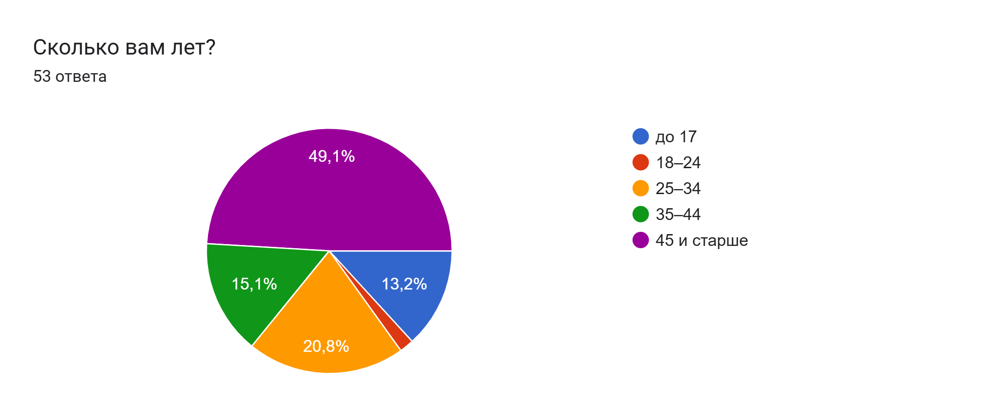
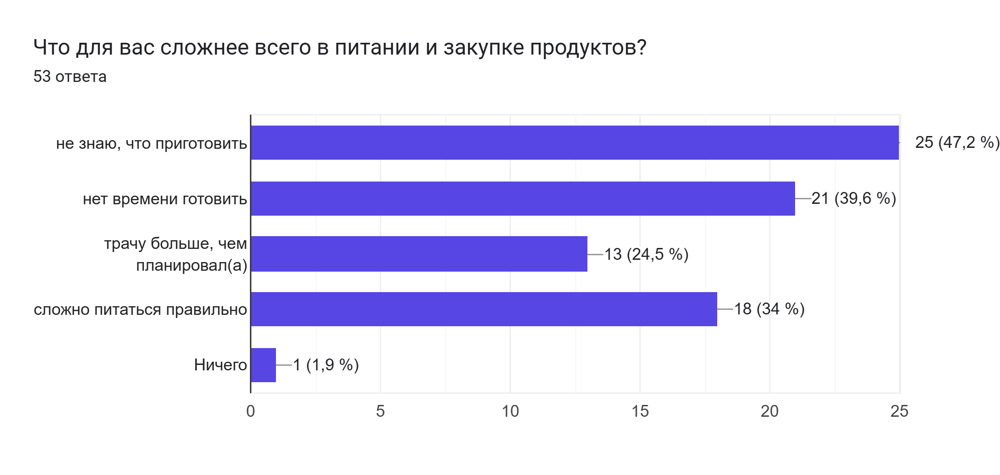
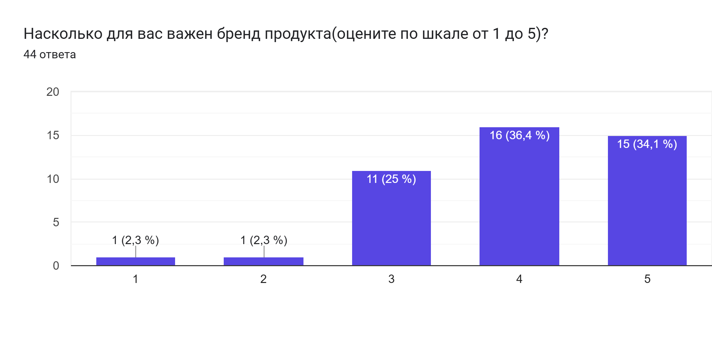
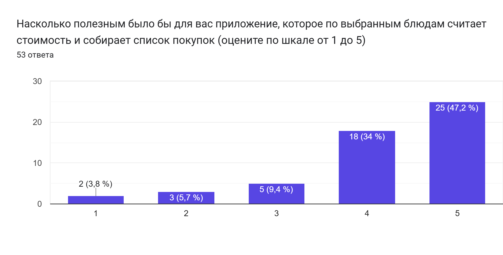

# Миронов Степан - ЕдуКупи

### Группа: 10И5
### Электронная почта: samironov_2@edu.hse.ru
### Tg: @StepMir

**[ НАЗВАНИЕ ПРОЕКТА ]**

ЕдуКупи: мобильное приложение для планирования питания на неделю с расчётом КБЖУ и стоимости блюд

**[ ПРОБЛЕМНОЕ ПОЛЕ ]**

Правильное питание требует соблюдения баланса калорий, белков, жиров и углеводов (КБЖУ), а рост цен на продукты заставляет следить за расходами на еду. Чтобы питаться сбалансированно и в рамках бюджета, человеку необходимо:

1. Подобрать блюда так, чтобы рацион соответствовал нормам КБЖУ или укладывался в бюджет
2. Понимать, сколько будет стоить каждое блюдо и весь план питания целиком
3. Составить список покупок, чтобы не тратить деньги и время на лишнее

На это уходит много времени, которого у работающих людей и семей обычно нет, а тем, кто только начинает жить самостоятельно, не хватает опыта. Существующие сервисы решают эти задачи по отдельности: одни предлагают рецепты и общие меню на неделю, другие считают калории и составляют планы питания, третьи показывают цены и скидки в магазинах. Однако, насколько мне известно, ни один из имеющихся программных продуктов не объединяет в одном приложении:

1. Составление меню на неделю под норму КБЖУ пользователя или под его бюджет
2. Расчёт стоимости каждого блюда и всего меню на основе актуальных цен магазина
3. Список покупок, собранный из меню с учётом количества человек

Мой продукт позволит решить эти проблемы: пользователь указывает свои параметры, количество человек и выбирает, по какому принципу составить меню: под норму КБЖУ или под бюджет на неделю. Приложение составляет меню, считает его стоимость и КБЖУ и формирует список покупок.

**[ ЗАКАЗЧИК / ПОТЕНЦИАЛЬНАЯ АУДИТОРИЯ ]**

Программный продукт ориентирован на русскоязычных пользователей, которые сами покупают продукты и готовят для себя и семьи и хотят питаться сбалансированно, не тратя лишнего. К основным группам пользователей относятся:

* Семейные люди 45+, которые почти каждый день готовят на 2-4 человек и тратят много времени на то, чтобы придумать меню и составить список покупок
* Работающие люди 25-44 лет, которым нужно быстро планировать питание на себя или на всю семью
* Люди, которые следят за КБЖУ или планируют начать и хотят питаться правильно без ручных подсчётов

Чтобы проверить, нужен ли такой продукт, я провёл опрос в Google Формах (октябрь 2026, 53 респондента). Основные результаты:

* 49% опрошенных старше 45 лет, ещё 36% в возрасте 25-44 лет
* 83% сами покупают продукты, из них 59% покупают на семью из 3 и более человек
* Главные трудности: «не знаю, что приготовить» (47%), «нет времени готовить» (40%), «сложно питаться правильно» (34%), «трачу больше, чем планировал(а)» (25%)
* Только 25% покупателей заранее составляют список покупок
* 70% покупателей оценили важность бренда продукта на 4-5 из 5
* 40% следят за КБЖУ или планируют начать
* 81% оценили полезность приложения, которое считает стоимость блюд и собирает список покупок, на 4-5 из 5 (средняя оценка 4,2), а среди людей 45+ таких 85%

**[ АППАРАТНЫЕ / ПРОГРАММНЫЕ ТРЕБОВАНИЯ ]**

Продукт разрабатывается для мобильных устройств и к моменту сдачи должен существовать в виде версии для следующей конфигурации:

* Android: версия 7.0 (Nougat) и выше, 2 Гб оперативной памяти, 200 Мб свободного места, подключение к интернету

**[ ФУНКЦИОНАЛЬНЫЕ ТРЕБОВАНИЯ ]**

Программный продукт будет предоставлять следующие возможности:
* Регистрация и авторизация пользователя
* Создание профиля пользователя: возраст, пол, вес, рост, уровень активности, цель (поддержание веса, снижение веса, набор массы)
* Автоматический расчёт нормы КБЖУ пользователя
* Указание количества человек, на которых готовится еда
* Составление меню на неделю в одном из двух режимов на выбор пользователя:
  * под норму КБЖУ: подбор блюд, близких к дневной норме калорий, белков, жиров и углеводов
  * под бюджет: подбор блюд так, чтобы стоимость меню на неделю не превышала заданную сумму
* Замена блюда в меню с пересчётом КБЖУ и стоимости
* Просмотр каталога блюд с рецептами, списком ингредиентов, КБЖУ и стоимостью
* Расчёт стоимости и КБЖУ блюда и всего меню на основе актуальных цен и состава товаров сети «ВкусВилл»
* Автоматическое формирование списка покупок из меню с учётом количества человек
* Отметка купленных продуктов в списке покупок

В перспективе, после защиты проекта, планируется добавить: выбор ближайшего магазина по местоположению пользователя, цены других сетей (в первую очередь Ленты) и выбор брендов продуктов с пересчётом стоимости и КБЖУ блюда, отметку продуктов, которые уже есть дома, чтобы убрать их из списка покупок, поиск и фильтрацию блюд, учёт аллергий и продуктов, которые пользователь не ест, а также составление меню, одновременно учитывающего и КБЖУ, и бюджет.

**[ ПОХОЖИЕ / АНАЛОГИЧНЫЕ ПРОДУКТЫ ]**

Анализ 4 программных продуктов, которые максимально приближены к заданному функционалу, показал, что:

* Food.ru: меню на неделю составляется редакцией и одинаково для всех пользователей и не подстраивается под количество человек, нормы КБЖУ и бюджет; стоимость меню не рассчитывается
* Тарелка: не рассчитывает стоимость блюд и меню и не позволяет задать бюджет на питание
* Croopa: без подписки показывает план питания только на один день: даже план на следующий день открывается лишь по подписке стоимостью от 200 до 400 ₽ в месяц; считает калорийность и БЖУ и формирует список продуктов, но не показывает стоимость продуктов, блюд и меню и не учитывает бюджет; заказать продукты можно только с доставкой через сервис «Купер»
* Mealime: не показывает стоимость блюд, не учитывает цены в российских магазинах и ориентирован на англоязычных пользователей

**[ ИНСТРУМЕНТЫ РАЗРАБОТКИ, ИНФОРМАЦИЯ О БД ]**

* Dart и Flutter: для разработки Android-версии
* Python и FastAPI: для разработки серверной части
* VS Code: среда разработки
* PostgreSQL: для хранения пользователей, рецептов, продуктов и цен
* Docker и Docker Compose: для развёртывания базы данных и серверной части
* Figma: для проектирования интерфейса
* Git и GitHub: для контроля версий

Источник цен и КБЖУ: официальный открытый MCP-сервер сети «ВкусВилл» (каталог товаров с ценами, составом и КБЖУ). Для продуктов, у которых нет данных ВкусВилла, КБЖУ берётся из открытых таблиц химического состава продуктов.

**[ ЭТАПЫ РАЗРАБОТКИ ]**

* Разработка пользовательских сценариев
* Проектирование интерфейса в Figma
* Проектирование базы данных
* Разработка серверной части
* Наполнение базы: 50-100 блюд с рецептами и около 200 продуктов, привязанных к товарам ВкусВилла
* Интеграция с MCP-сервером ВкусВилла: ежедневная загрузка цен и КБЖУ для продуктов из базы
* Реализация регистрации и авторизации
* Реализация модуля расчёта норм КБЖУ
* Реализация составления меню в двух режимах: под КБЖУ и под бюджет
* Реализация модуля расчёта стоимости блюд и списка покупок
* Тестирование, отладка
* Подготовка проекта к защите

**[ ВОЗМОЖНЫЕ РИСКИ ]**

* Большинство продуктовых сетей не открывают доступ к ценам, поэтому в первой версии стоимость меню считается только по ценам сети «ВкусВилл»; жители городов, где её нет, в первой версии не смогут пользоваться приложением
* MCP-сервер ВкусВилла находится в бета-версии и ограничен 60 запросами в минуту; он может измениться или стать недоступным
* Проект некоммерческий; если в будущем приложение станет платным, использовать данные ВкусВилла можно будет только после получения письменного разрешения сети
* Устаревание данных о ценах и акциях
* Большой объём работы по наполнению базы рецептов и продуктов с точными значениями КБЖУ
* Неправильная оценка стека технологий, которые мне необходимо изучить, и, как следствие, нехватка времени на изучение Flutter, Dart, Python, FastAPI, Docker и работы с базами данных
